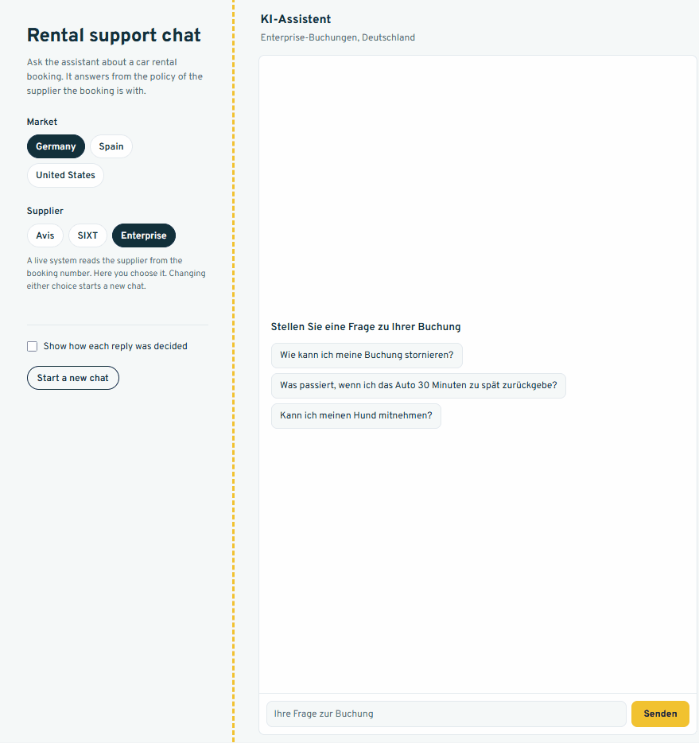
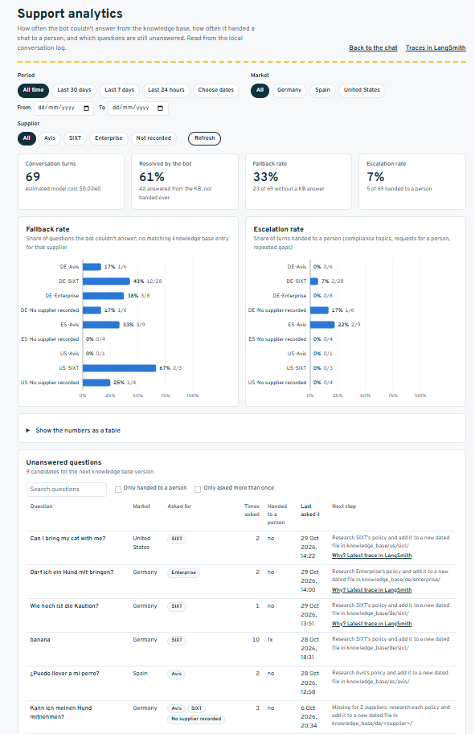
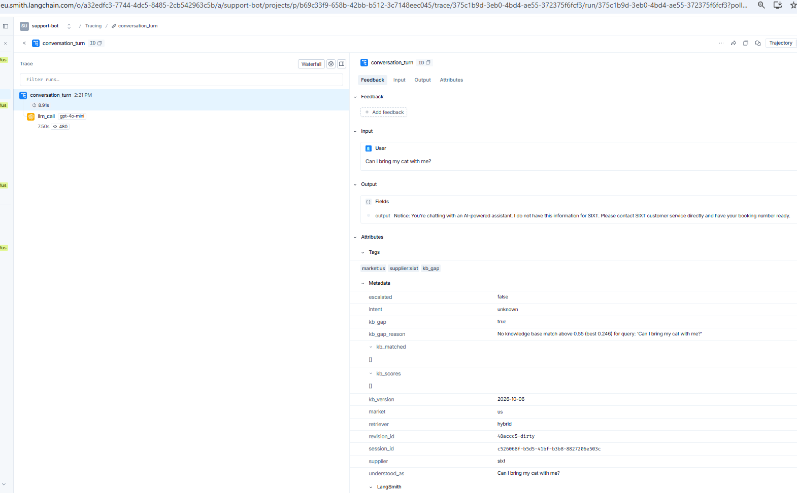
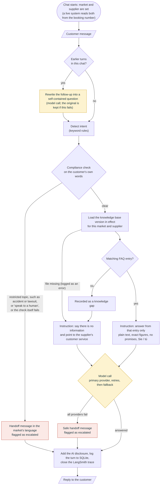
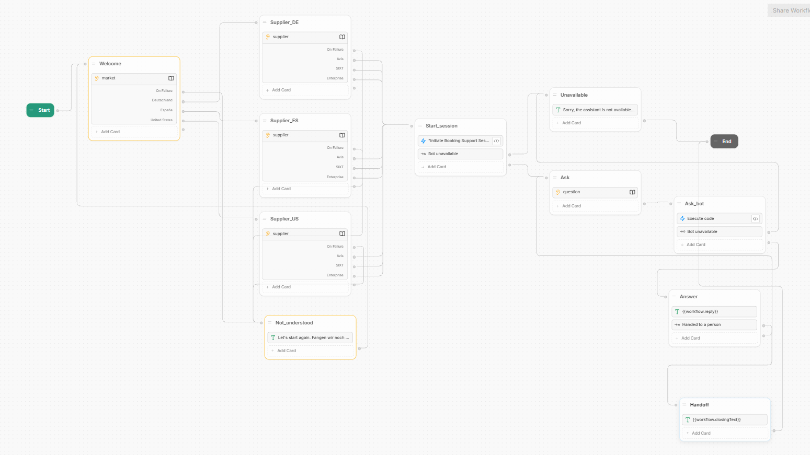

# Multi-Market Rental Support Bot

A modular, production-minded support chatbot for an international car
rental broker. It answers in three markets (Germany, Spain, US) and for three
suppliers (Avis, SIXT, Enterprise), from knowledge bases built on the
suppliers' published policies. Built to practice the skills behind an
"AI Bot Consultant" role: market rollout, bot behavior design, localized
knowledge base management, compliance, and performance analytics.



Runs with **zero LLM API keys** (uses a deterministic `MockProvider`),
so the conversation logic can be tried without paying for a model. Real
providers (OpenAI, Anthropic) are optional drop-in upgrades controlled by
environment variables. **LangSmith tracing is required**: every
conversation turn is traced, and the bot refuses to start without a working
`LANGSMITH_API_KEY`.

## Quick start

```bash
git clone <this-repo>
cd support-bot
cp .env.example .env
# fill in LANGSMITH_API_KEY (required)
pip install -r requirements.txt
python main.py
```

On startup the bot checks the LangSmith connection and creates the
`support-bot` project if it doesn't exist yet. It then asks for the market
(de, es, us) and the rental supplier (Avis, SIXT, Enterprise), because the
answer to most questions depends on both. To use real LLM providers,
also fill in `OPENAI_API_KEY` and/or `ANTHROPIC_API_KEY` in `.env`.

The first start also downloads the embedding model for knowledge search
(about 220 MB, once, into `.model_cache/`, which is not committed). To compare the two retrievers on the labelled
question set: `python tests/evaluate_retrieval.py`.

### Web chat

The same bot is also available as a chat page in the browser:

```bash
python web_app.py
```

Then open http://127.0.0.1:5000. Choose the market and the supplier on the
left and chat on the right; the chat's language follows the market. Tick
"Show how each reply was decided" to see the intent, whether the knowledge
base had an answer, and whether the turn was handed to a person.

The page (`web/index.html`) is only the front door: it sends each message to
a small web service (`web_app.py`), which calls the same
`flow_engine.handle_message` as the terminal version. A WhatsApp or Teams
connection would be another front door on the same `/api/chat` endpoint.
This is a local demo server with no login and no rate limit, so it listens
on 127.0.0.1 only.

### Analytics dashboard

While `web_app.py` runs, http://127.0.0.1:5000/dashboard shows what the
conversation log says. The filters above the charts (period or your own
dates, market, supplier) apply to the whole page; the unanswered-questions
table also has a search, "only handed to a person" / "only asked more than
once" toggles and sortable columns:



- **Resolved by the bot, fallback rate, escalation rate** as totals, and the
  fallback and escalation rates per market and supplier. Each bar shows the
  count next to the rate (`3/7`), so a rate built on a few turns is not
  mistaken for a trend.
- **Unanswered questions**: identical questions are counted together per
  market, with the suppliers they were asked for and a **next step**. One
  supplier: research that supplier's policy and add a new dated KB file. Several
  suppliers: the topic is missing from the market, to be researched per
  supplier, because their policies differ. After the new KB file is live,
  the question disappears from the list, which closes the loop shown in
  the improvement-loop diagram.
- **Business analytics here, engineering observability in LangSmith,
  linked.** Every turn's LangSmith trace id is stored in the log, so each
  unanswered question links to its latest trace ("Why?"), which shows the
  question as the bot understood it, the retrieval scores and the prompt.
  The header links to the project's trace list. If LangSmith can't be
  reached, the dashboard works the same without the links. The SQLite log
  stays the source for the numbers: it is kept as long as needed and is
  written even when a trace fails.

  
- The numbers come from `analytics/dashboard.py`'s `collect()`, which also
  prints the same report in the terminal (`python analytics/dashboard.py`).
  The dashboard is only on the local web app, never on the channel API,
  because it shows what customers wrote.

### Channel API (for Botpress and other platforms)

Chat platforms run in the cloud and call the bot over the internet, so they
get their own entry point with an access key:

```bash
python bot_api.py
```

It needs `SUPPORT_BOT_API_KEY` in `.env` (a random value of at least 20
characters) and refuses every request without it in the `X-API-Key` header.
It runs on port 5001 and exposes only `/v1/config`, `/v1/sessions` and
`/v1/chat`, not the demo page, and it stops answering after 30 requests a
minute so a misconfigured flow cannot spend tokens without limit. To reach it
from a cloud platform during a demo, put a tunnel in front of port 5001, for
example `cloudflared tunnel --url http://127.0.0.1:5001`.

### Terminal

Type `report` inside the chat session at any point to see the analytics
summary (KB gap rate, escalation rate, estimated cost). The report covers
every turn stored in `support_bot.db`, so it includes earlier sessions, not
only the current one.

## Conversation flow

What happens to each customer message (`flow/flow_engine.py`):



The diagram's source is [docs/diagrams/conversation-flow.mmd](docs/diagrams/conversation-flow.mmd)
(Mermaid). To change it, edit the source, paste it into
[mermaid.live](https://mermaid.live), and export the PNG over the old one.

## No-code flow in Botpress

The conversation flow is also built in [Botpress](https://botpress.com), a
visual bot builder. Botpress runs the conversation; the Python bot does the
answering through the channel API (`bot_api.py`).



| Node | What it does |
|---|---|
| `Welcome` | Greets in three languages, says it is an AI assistant, asks for the country |
| `Supplier_DE` / `_ES` / `_US` | Market branching: asks for the rental supplier in the market's language |
| `Not_understood` | Any answer that matches no button: asks the customer to pick a button, then starts over |
| `Start_session` | Code step: opens a session with the Python bot (`POST /v1/sessions`) |
| `Ask` | Captures the customer's question in the market's language |
| `Ask_bot` | Code step: sends the question to the Python bot (`POST /v1/chat`) |
| `Answer` | Shows the bot's reply, then loops back to `Ask` |
| `Handoff` | Taken when the Python bot escalates (accident, lawsuit, "speak to a human"): closing message, end |
| `Unavailable` | Taken when the Python bot cannot be reached: apology, end |

The API key and address are Botpress configuration variables (`apiKey`,
`apiUrl`), so neither appears in the flow itself.

To import the bot into your own Botpress workspace, use the export file
[`botpress/carrental-support-bot.bpz`](botpress/carrental-support-bot.bpz), set
`apiKey` and `apiUrl` in the bot settings, and run `bot_api.py` with a tunnel
as described under [Channel API](#channel-api-for-botpress-and-other-platforms).

## Rollout

The project was rolled out market by market in a simulation: Germany first,
then Spain and the US, then per-supplier answers, the web chat and follow-up
questions. Each phase found a concrete problem in testing and fixed it,
from a Spanish question that was neither answered nor counted as a gap to a
bot that promised a human handoff it could not make. The full write-up, with
the go-live criteria per market, is in [docs/ROLLOUT.md](docs/ROLLOUT.md).

## Architecture

```
support-bot/
├── config.py             # all settings: markets, suppliers; forces LangSmith tracing on
├── exceptions.py          # shared exception hierarchy for precise error handling
├── main.py                 # terminal entry point
├── web_app.py              # web entry point: small Flask service + chat page
├── bot_api.py              # channel API for chat platforms (key-protected)
├── web/
│   ├── index.html           # the chat page (HTML, CSS and JS in one file)
│   └── dashboard.html       # analytics charts + unanswered questions
├── models/
│   ├── llm_client.py        # provider chain + retry + fallback + graceful degrade
│   └── disclosure.py         # enforces "I'm an AI" in code, not just a prompt
├── knowledge/
│   ├── kb_loader.py           # loads the KB version in effect for one market + supplier
│   ├── retrieval.py            # picks the retriever; falls back to keywords if vector search fails
│   ├── vector_retriever.py     # LangChain + Chroma + local multilingual embeddings
│   └── retriever.py            # weighted keyword retrieval (fallback) + KB-gap detection
├── tests/
│   ├── retrieval_questions.py   # labelled questions per market, incl. held-out phrasings and gaps
│   └── evaluate_retrieval.py    # keyword vs. vector accuracy + threshold sweep
├── flow/
│   ├── intents.py               # rule-based intent classification
│   ├── flow_engine.py            # orchestrates one full conversation turn; builds the prompt
│   └── memory.py                 # last turns per conversation, for follow-up questions
├── compliance/
│   └── rules.py                   # fail-CLOSED escalation rules per market
├── observability/
│   ├── langsmith_setup.py          # startup check + creates the LangSmith project
│   ├── tracing.py                  # one LangSmith trace per turn (always on)
│   └── logger.py                    # SQLite logging with flat-file fallback
├── analytics/
│   └── dashboard.py                  # reads the log: rates, unanswered questions, next steps
└── knowledge_base/
    ├── CHANGELOG.md                  # what changed in each KB version, and why
    ├── SOURCES.md                    # where every FAQ fact comes from, and known gaps
    ├── de/
    │   ├── avis/2026-10-06.md        # one dated file per KB version
    │   ├── enterprise/2026-10-06.md
    │   └── sixt/2026-10-06.md
    ├── es/  (same layout)
    └── us/  (same layout)
```

Each module does one job and can be read/reviewed independently — you
don't need to understand LangSmith to review `flow_engine.py`.

## How this maps to real "AI Bot Consultant" requirements

| Requirement | Where it lives |
|---|---|
| Market deployment & prioritization | `knowledge_base/{market}/{supplier}/`, `config.SUPPORTED_MARKETS`, `config.SUPPLIER_NAMES` — a new market is a folder, a new supplier is one folder per market plus one line in `config.py` |
| Feature design & bot behavior | The Botpress flow (market branching, fallback, handoff and error paths) on top of `flow/intents.py` + `flow/flow_engine.py`, readable without touching the LLM layer |
| Knowledge base management | `knowledge/kb_loader.py` — plain markdown, one dated file per KB version for each market and supplier; `knowledge_base/CHANGELOG.md` records what changed and why, `knowledge_base/SOURCES.md` the source of every fact |
| Compliance & localization | `compliance/rules.py` (fail-closed escalation) + `models/disclosure.py` (AI disclosure enforced in code) + per-market tone in `flow_engine._escalation_response` |
| Performance analytics | `/dashboard` + `analytics/dashboard.py` — fallback, escalation and resolution rates per market and supplier, and the unanswered questions with a next step for each, from real logged data |

## Design decisions worth explaining in an interview

- **Retry, then fallback, then degrade — never crash.** `models/llm_client.py`
  retries the primary provider on transient errors, falls through to a
  secondary provider, and if both fail, returns a safe human-handoff
  message instead of raising an exception. Auth errors skip retries
  entirely, since retrying a bad key never helps.
- **Compliance fails CLOSED.** If the compliance rule engine itself throws
  an unexpected error, `flow_engine.py` treats that as "escalate to a
  human" rather than "skip the check." Getting this backwards turns a bug
  into a compliance incident.
- **AI disclosure is structural, not a prompt instruction.** Every response
  passes through `disclosure.py`, so you can prove compliance with a code
  path instead of trusting the model to remember to mention it.
- **Logging failures never break the conversation.** If SQLite is
  unavailable, `observability/logger.py` falls back to a flat JSONL file
  rather than raising — you lose query-ability, never data, and the user
  never sees a broken bot because of a logging problem.
- **KB gaps are a first-class signal, not a silent failure.** When nothing
  in the knowledge base clears the match threshold, that's logged
  explicitly (`KBGapError`) and surfaced in the analytics report as a
  candidate for a new KB entry — this is what "identify knowledge gaps"
  actually looks like in code.
- **Two unanswered questions in a row → a person.** The first question the
  knowledge base can't answer gets an honest "I don't have that
  information". If the next one can't be answered either, the bot hands
  over instead of repeating itself (`SUPPORT_BOT_MAX_CONSECUTIVE_GAPS`,
  default 2, common for chat; voice bots often allow 3). An answered
  question resets the count. The turn is logged as both a gap and an
  escalation, and skips the model call. Because the rule lives in the
  Python bot, the web chat and Botpress behave the same without changes
  to the flow.
- **Tracing is mandatory and fails fast.** `observability/langsmith_setup.py`
  verifies the key and endpoint at startup and creates the project if it
  doesn't exist; a missing key, missing SDK, or rejected login stops the
  bot with a clear message instead of producing conversations nobody can
  inspect later.
- **Answers are per supplier, never mixed.** Cancellation fees and late-
  return rules differ between Avis, SIXT and Enterprise and between
  markets, so each combination has its own FAQ file and a question is only
  ever answered from the customer's supplier. The bot asks for the supplier
  at the start of a session; a real deployment would read it from the
  booking number. The FAQ content is taken from the suppliers' public help
  pages (see `knowledge_base/SOURCES.md`) and must be re-checked before
  real use.
- **Follow-up questions are rewritten before retrieval.** The bot keeps
  the last three turns of each conversation (`flow/memory.py`). A
  follow-up such as "Und bei zwei Stunden?" has no topic of its own; on its
  own the keyword retriever matched it to the *cancellation* entry (through
  "24 Stunden"). So from the second message on, one extra model call turns
  the message into a self-contained question ("Was passiert, wenn ich das
  Auto zwei Stunden zu spät zurückgebe?"), and intent detection and
  retrieval use that question. The answer call also sees the recent turns.
  This is the "history-aware retriever" pattern from LangChain, written out
  by hand. If the rewrite fails or returns something unusable, the
  original message is used, so memory can only help, never break a turn.
  The compliance check always runs on the customer's own words. The extra
  call is traced as `rewrite_question` and its tokens and cost are added to
  the turn.
- **Knowledge base versions are dated files, never edits.** A policy
  change is a new file named after the day it takes effect
  (`knowledge_base/de/sixt/2026-11-01.md`); the loader uses the newest
  file dated today or earlier. Old versions stay on disk, so you can always
  show what the bot was allowed to say on a given day, prepare an announced
  change in advance with a future date, and roll back by deleting one
  file. Each LangSmith trace records the KB version that answered, and
  `python knowledge/kb_loader.py` lists which version is live everywhere.
- **One trace per conversation turn, not per model call.** Every customer
  message becomes a `conversation_turn` trace in the `support-bot` project,
  with the customer message as input and the bot's reply as output. The
  model call is a step inside it (prompt, reply, model, token counts).
  Because the trace wraps the whole turn, messages that are escalated
  before any model is called are visible too. Turns are tagged
  `market:<market>` and `supplier:<supplier>`, plus `escalated` and `kb_gap`
  where they apply, so
  each can be filtered in LangSmith.
- **Hybrid retrieval: keywords first, LangChain + Chroma for the rest.**
  `knowledge/vector_retriever.py` turns each FAQ entry into embeddings with
  a local multilingual model (FastEmbed, no API key, no cost per question)
  and stores them in a Chroma collection per market + supplier + KB
  version, so a SIXT question can never match an Avis entry and a new
  dated KB file gets a fresh index. Each entry gets a vector for its
  heading and one for heading + text; the better match counts, because a
  long entry mixes several subjects and blurs its vector.
  The decision to go hybrid came from measuring, not from assumption.
  `tests/evaluate_retrieval.py` runs labelled questions (DE/ES/US)
  against all three suppliers: tuned-on phrasings, *held-out* phrasings
  the keyword rules were never tuned on, and questions the FAQ does not
  answer. Results with the 2026-10-06 knowledge base (51 questions, 153
  checks; the set has grown since, see below):

  | Variant | Correct | Held-out | Gaps kept | Wrong entry |
  |---|---|---|---|---|
  | Keyword only | 116 (76%) | 33/69 | 38/39 | 19 |
  | Vector only (best threshold 0.40) | 119 (78%) | 44/69 | 32/39 | 30 |
  | **Hybrid (threshold 0.55)** | **124 (81%)** | **41/69** | **38/39** | 22 |

  After the 2026-10-29 release (pets added, 56 questions, 168 checks):
  keyword 131, hybrid at 0.55 **139**, with 56/84 held-out phrasings and
  29/30 gaps kept; 0.55 is still on the plateau, so it was kept.

  Vector search alone handled rephrasings far better ("Ich stehe im
  Stau…" finds *Verspätete Rückgabe* without a shared word) but confused
  neighbouring topics (*cancel* vs. *change* a booking) and answered
  questions the FAQ doesn't cover. Keyword matching is the opposite. In
  hybrid mode the keyword matcher answers when it is sure, and the vector
  search decides only when it finds nothing. 0.55 sits on a plateau
  (124/123 correct at 0.55/0.60) rather than a single peak, so small
  differences in wording don't flip results; it keeps every gap the
  keyword matcher keeps. Each turn's LangSmith trace records the
  retrieval mode and the scores.
- **Retrieval never breaks a conversation.** `knowledge/retrieval.py`
  loads the model at startup (the startup line says which search is
  active). If the packages are missing or the model can't be downloaded,
  it logs the reason and uses keyword matching instead.
- **Keyword retrieval that knows its limits (fallback).** `knowledge/retriever.py`
  scores FAQ entries by shared words, with six rules that each fix a wrong
  answer seen in testing: accents are folded ("devolucion" = "devolución"),
  synonyms map customer words to the FAQ's words ("estatus" → "estado"),
  word forms are matched ("later" = "late", "Status" finds
  "Buchungsstatus"), a word counts for less the more entries contain it
  ("booking" alone never matches), a word in an entry's heading counts
  double, and words the FAQ never uses don't dilute the score, so long
  questions match as well as short ones. Ties return all tied entries instead of the first
  one in the file.
- **Reply rules live in the prompt, with their reasons.** `flow_engine.py`
  tells the model to write plain text (the chat window doesn't render
  Markdown) and to keep time limits, amounts and conditions exactly as the
  FAQ states them. These are instructions, not guarantees: unlike the AI
  disclosure, they are not enforced in code.
- **Region-aware LangSmith endpoint.** LangSmith defaults to its US
  endpoint; EU-hosted accounts need `LANGSMITH_ENDPOINT` set explicitly
  (defaults to `https://eu.api.smith.langchain.com` in `config.py`) or
  traces fail to authenticate silently. This is set on both the
  `LANGSMITH_*` and legacy `LANGCHAIN_*` env vars *and* passed explicitly
  to the `Client`, since different SDK versions read different names —
  a small but real "it works on my machine" trap worth knowing about.

## Known limitations (intentional, for a learning project)

- Intent classification is still keyword-based. In hybrid mode the
  keyword matcher goes first, so its confident mistakes are not corrected
  ("Is my reservation confirmed?" matches *Cancel a booking* through the
  word "reservation"). Some questions are ambiguous by nature ("pick up
  the car a day later" is a *change*, but sounds like a *late return*).
- The evaluation set is small (56 questions), and the variant and
  threshold were chosen on it, so the numbers are optimistic. New
  real questions from the gap report should be added to it before
  changing the settings again. One threshold serves all three languages.
- Vector indexes are rebuilt in memory at every start. With four entries
  per supplier that takes under a second; a large KB would use a
  persistent Chroma directory.
- Session state (`models/disclosure.py`, `flow/memory.py`) is in-memory
  and resets on restart — fine for a demo, would move to Redis/a DB in production.

## Next steps to extend this further

- Swap `flow/intents.py`'s keyword classifier for an LLM-based one and
  compare accuracy/cost trade-offs.
- Close the next gaps the same way pets were closed (see
  `docs/ROLLOUT.md`, phase 11): additional drivers and deposits are the
  most-asked remaining topics.
- Publish the Botpress flow as a webchat with the Python bot hosted at a
  permanent address instead of a tunnel.
