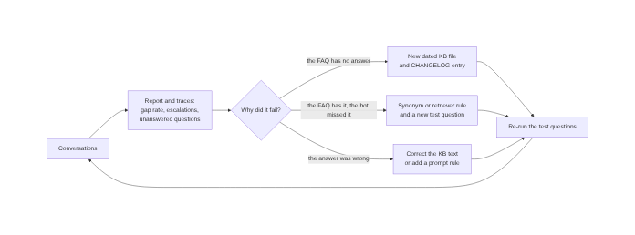

# Rollout simulation

This is a simulated rollout. The conversations were test questions written
during development, not customer traffic, so there are no real volumes or
rates here. Every finding below did happen in testing, and each one points
to the change it caused in this repository.

## Why Germany first

Germany combines the hardest requirements of the three markets, so a bot that
passes there needs mostly configuration for the others:

- **Transparency:** the EU AI Act's transparency rules (Article 50) require
  a chatbot to tell people they are talking to an AI. This applies in Spain
  too, but Germany was where the disclosure was built and checked first.
- **Formal register:** German support uses the formal "Sie", and a bot that
  slips into "du" reads as careless. Spanish ("tú") and English need less
  care here.
- **Hard language for keyword retrieval:** German compounds
  ("Buchungsstatus", "Bearbeitungsgebühr") and separable verbs
  ("gebe ... zurück") break simple word matching first, so problems show up
  early.

## Go-live criteria for each market

A market goes live only when all of these hold:

| Check | How it is verified |
|---|---|
| Every reply identifies itself as AI | Enforced in code (`models/disclosure.py`), so it cannot be skipped |
| Regulated topics go to a person | Test messages with the market's restricted words (accident, lawsuit, Unfall, accidente) must escalate |
| Core questions get the right supplier's entry | Retrieval test questions for cancel, change, booking status and late return pass for every supplier |
| The bot promises nothing it cannot do | Reviewed replies contain no "I will connect you" without an actual escalation |
| Known gaps are written down | Open gaps are listed in `knowledge_base/CHANGELOG.md` before launch |

## What happened, phase by phase

### Phase 1: Germany pilot with one FAQ per market

Escalation, the AI notice and gap recording worked. The first real gap was
recorded: "Kann ich meinen Hund mitnehmen?" (pets). It is still open; see
the last section.

### Phase 2: Spain

**Finding:** "¿Dónde puedo encontrar el estatus de mi reserva?" was neither
answered nor recorded as a gap. The FAQ says "estado", the customer wrote
"estatus", and the shared word "reserva" pulled in the cancellation entry
instead. This is worse than a gap, because the gap rate showed 0% while a
customer got no answer.

**Change:** the retriever gained synonyms, accent folding, and a rule that
words appearing in most entries ("reserva", "Buchung") do not count as
evidence (`knowledge/retriever.py`).

**Lesson:** a low gap rate is not proof of good answers. Answered
conversations need sampling too, not only the gap list.

### Phase 3: United States

**Finding:** "What would happen if I return the car 30 minutes later than the
agreed return time?" was recorded as a gap although the FAQ answers it. Long,
polite questions diluted the score below the threshold.

**Change:** words the FAQ never uses no longer count against a match, and
word endings are matched ("later" finds "late").

### Phase 4: answers per supplier

**Finding:** answers depend on the supplier as much as on the market. Prepaid
cancellation, for example, costs $50 or $150 with Avis in the US but is free
up to 7 days before pick-up with Enterprise in Germany.

**Change:** one FAQ file per market and supplier, built from the suppliers'
public help pages (`knowledge_base/SOURCES.md`), and a supplier choice at
the start of each chat.

Testing with the real supplier texts led to three more corrections:

- **Retrieval:** 13 of 81 test questions failed on the new texts. Heading
  words now count double and German compounds are matched; all 81 pass.
- **An overstated answer:** for SIXT Germany the bot said "Es gibt keine
  Kulanzzeit" and that 30 minutes late costs an extra day. SIXT's page only
  says it does not state a grace period. The KB text was corrected (see the
  CHANGELOG) and the prompt now forbids turning "not stated" into "does not
  exist".
- **Form of address:** the bot switched between "du" and "Sie" within one
  chat. The prompt now fixes the form of address per market.

### Phase 5: web chat

**Finding:** for an unanswered question the bot wrote "stelle ich Sie gerne
mit einem Mitglied unseres Teams in Verbindung", but nothing was escalated.
The customer would wait for a person who never comes.

**Change:** the bot may not offer actions it cannot take; for unanswered
questions it points to the supplier's customer service instead.

### Phase 6: follow-up questions

**Finding:** "Und bei zwei Stunden?" after a late-return question was matched
to the *cancellation* entry (through "24 Stunden").

**Change:** the bot keeps the last three turns and rewrites a follow-up into
a self-contained question before searching the FAQ (`flow/memory.py`).

## How a gap becomes a fix

Source: [diagrams/improvement-loop.mmd](diagrams/improvement-loop.mmd)

## Open findings

- **Topics not covered:** pets, additional drivers, deposits, fuel and age
  limits are answered with "no information". These are the next KB entries.
- **SIXT cancellation fees:** the amounts are not on SIXT's help pages and
  still need to be added by hand.
- **Intent analytics:** late-return questions are counted as "unknown"
  because `flow/intents.py` has no intent for them.
- **Keyword retrieval is near its limit:** each phase above needed another
  matching rule. Embeddings would replace those rules (see the upgrade path in
  `knowledge/retriever.py`).
